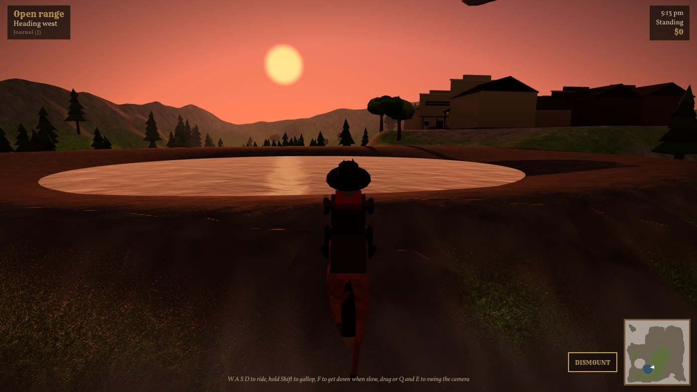

# Sunset Territory

An original open world western for the browser. Ride a valley at your own pace, take odd jobs from the people in its two towns and two camps, and save up for a homestead of your own. Built for phones first: it runs in Safari on an iPhone and can be added to the home screen to play full screen.

**Play:** https://drewc611.github.io/sunset-territory-/

## Controls

| | Phone | Keyboard and mouse |
|---|---|---|
| Ride | Stick, bottom left | W A S D or arrows |
| Gallop | Hold GALLOP | Hold Shift |
| Camera | Drag the right half of the screen | Drag, or Q and E |
| Talk, get down, mount, whistle | The action button above GALLOP | F |
| Whistle for your horse | Action button when far from it | H |
| Journal and settings | Tap the place name, top left | J |

## How it plays

Eight people across Brass Hollow, Caldwell Crossing, Drover's Camp and Widow's Rest have work: deliveries, a powder run you can't gallop, scouting Kettle Ridge, lake water for the doctor, and three stray steers to drive home. Four landmarks (a sandstone arch, a mine, a fire lookout and an old mission) have jobs of their own once you've worked a while. Jobs show on the minimap as a brass ring. Ida Pell in Brass Hollow sells the homestead deed for $60. Progress saves to your browser on its own.

## Run it locally

Needs Node 20.19 or newer.

    npm install
    npm run dev          # http://localhost:5173
    npm run dev -- --host  # also reachable from a phone on the same Wi-Fi
    npm run build        # static site in dist/

## Debug switches

Add these to the URL:

- `?perf` shows the performance readout (fps, frame time, draw calls, triangles, texture memory). On a phone, triple tap the clock instead.
- `?bench` rides a fixed 90 second route at a gallop and reports frame times to paste into a PR. `?bench=30` for a shorter run.
- `?t=17.5` starts the day at 5:30 pm.
- `?at=x,z,heading` starts the rider at a map position (skips the save).
- `?debug` exposes game state on `window.__game` for scripted tests.

## Layout

    src/
      main.js        game loop, riding and on-foot movement, saving
      world.js       terrain height, places, lake (no three.js)
      terrain.js     textured ground shader
      sky.js         sky, sun, fog, day and night
      models.js      low poly trees, rocks, buildings, tents, built in code
      props.js       places everything, grass, water, dust
      character.js   jointed person for the player and townsfolk
      horse.js       horse model, gallop, rider seat
      npcs.js        townsfolk
      jobs.js        the odd jobs and the homestead deed
      collision.js   trees, rocks, buildings, water depth
      audio.js       synthesized sound and music
      quality.js     Low, Medium, High and automatic step down
      save.js        localStorage saves and settings
      ui.js          dialogue, journal, notices
      input.js       touch and keyboard
      camera.js      follow camera
      hud.js         place names, clock, minimap, discovery stamps
      debug/         perf readout and benchmark route
    public/assets/   models and textures, with LICENSES.md
    prototype/       the beta 0.2 single file build, kept as the behavior reference
    docs/            design rules, schedule, handover notes

## Deploys

`.github/workflows/pages.yml` publishes to GitHub Pages when game files change on `main`. It can also be run by hand from the Actions tab.

## Assets and license

Every asset is CC0, MIT, or made for this project, and each is recorded in `public/assets/LICENSES.md` before it lands. The game's own code and art are all rights reserved; see `LICENSE`. Security reports: see `SECURITY.md`.
