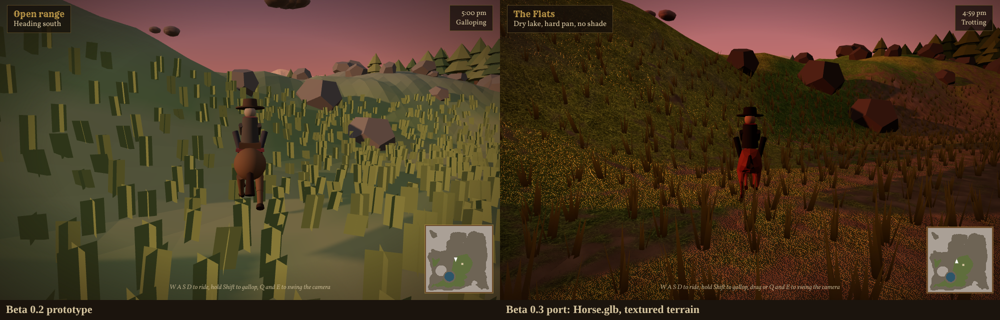

# Sunset Territory

An original open world western for the browser. Ride a valley at your own pace, find the towns and camps, and watch the day turn over the ridge line. Built for phones first: it runs in Safari on an iPhone and can be added to the home screen to play full screen.

**Play:** https://drewc611.github.io/sunset-territory-/

## Controls

| | Phone | Keyboard and mouse |
|---|---|---|
| Ride | Stick, bottom left | W A S D or arrows |
| Gallop | Hold GALLOP | Hold Shift |
| Camera | Drag the right half of the screen | Drag, or Q and E |

## Run it locally

Needs Node 20.19 or newer.

    npm install
    npm run dev          # http://localhost:5173
    npm run dev -- --host  # also reachable from a phone on the same Wi-Fi
    npm run build        # static site in dist/

## Debug switches

Add these to the URL:

- `?perf` shows the performance readout (fps, frame time, draw calls, triangles, texture memory). On a phone, triple tap the clock instead.
- `?bench` rides a fixed 90 second route at a gallop and reports frame times to paste into a PR. `?bench=30` for a shorter run.
- `?t=17.5` starts the day at 5:30 pm.

## Layout

    src/
      main.js        game loop and wiring
      world.js       terrain height, places, lake (no three.js)
      terrain.js     textured ground shader
      sky.js         sky, sun, fog, day and night
      props.js       trees, rocks, towns, camps, grass, water, dust
      horse.js       horse model, gallop, rider
      input.js       touch and keyboard
      camera.js      follow camera
      hud.js         place names, clock, minimap, discovery stamps
      debug/         perf readout and benchmark route
    public/assets/   models and textures, with LICENSES.md
    prototype/       the beta 0.2 single file build, kept as the behavior reference
    docs/            design rules, schedule, handover notes

## Deploys

`.github/workflows/pages.yml` publishes to GitHub Pages when game files change on `main`. It can also be run by hand from the Actions tab.

## Assets and license

Every asset is CC0, MIT, or made for this project, and each is recorded in `public/assets/LICENSES.md` before it lands. The game's own code and art are all rights reserved; see `LICENSE`. Security reports: see `SECURITY.md`.
